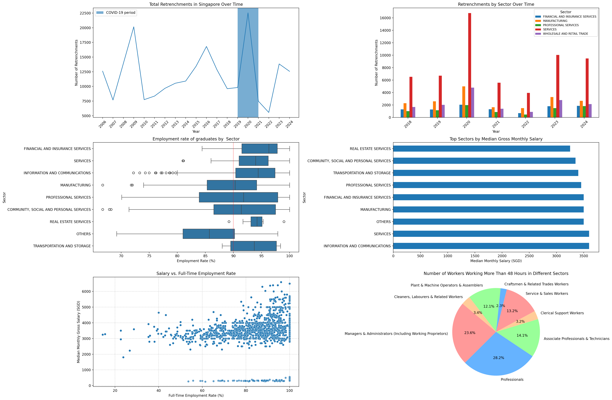

# Labour Market Insights Automation

An automated pipeline that answers one question about Singapore's job market:

> **How do retrenchment and workload patterns relate to salary outcomes in Singapore over time?**

A **UiPath** robot downloads the latest retrenchment data from the Ministry of Manpower's statistics site and runs a **Python** analysis script. That script cleans and merges four government datasets, renders a six-chart dashboard and writes up its findings. The robot then emails the report with the dashboard attached. A process that would normally take an afternoon of manual downloading, cleaning and charting runs from end to end with a single click.

<p align="center"></p>

## How the automation works

```
UiPath (uipath/Main.xaml)
 ├─ 1. Open Chrome at stats.mom.gov.sg → Retrenchment time series
 ├─ 2. Click the .xlsx download
 ├─ 3. Start Process → python analysis/labour_market_analysis.py
 │        ├─ clean + reshape 4 datasets
 │        ├─ save dashboard.png (6 charts)
 │        └─ write result.txt (findings + conclusion)
 ├─ 4. Read Text File → result.txt
 ├─ 5. Send Outlook mail: report body + dashboard.png attached
 └─ 6. Message box confirming completion
```

## Data sources

| Dataset | Source | Used for |
|---|---|---|
| Graduate Employment Survey (two files) | Ministry of Education, via data.gov.sg | Employment rates and salaries by degree |
| Retrenchment by industry, 2006 to 2024 | Ministry of Manpower | Retrenchment trends by sector |
| Labour Force Report 2023, Section F | Ministry of Manpower | Weekly hours worked by occupation and industry |

## Data engineering in the script

[`analysis/labour_market_analysis.py`](analysis/labour_market_analysis.py) handles several real-world data-cleaning problems:

- **Messy government spreadsheets.** It skips banner rows, promotes a data row to become the header, removes footnotes and "Source:" rows, and forward-fills merged category cells.
- **Inconsistent missing values.** Literal `'na'` strings and `'-'` placeholders are turned into proper nulls or zeros, and empty columns are dropped.
- **Wide to long reshaping.** Year columns are melted into tidy `(industry, year, value)` rows, and quarterly columns are removed.
- **Joining two survey files** on a shared key, then converting the salary columns to numeric types.
- **Mapping degrees to industries.** Each graduate degree is mapped to an industry sector with a keyword dictionary (for example, `comput`, `software` and `data` map to *Information & Communications*), so the graduate outcomes can be compared with the retrenchment data by sector.

## The dashboard

1. Total retrenchments from 2006 to 2024, with the COVID-19 period shaded
2. Retrenchments for the five most-affected sectors from 2018 to 2024
3. Graduate employment rate by sector (box plot, with a 90% reference line)
4. Median gross monthly salary by sector
5. Salary compared with the full-time employment rate
6. Share of workers doing more than 48 hours a week, by occupation

## Findings

- Retrenchments spike with economic shocks: 2009 and 2020 are the two peaks. **Services** and **Manufacturing** account for most retrenchments.
- **Financial & Insurance Services** graduates have the highest median employment rate. **Information & Communications** has the highest median salary, although the differences between sectors are small, at around S$3,300 to S$3,600.
- Higher full-time employment rates generally go with higher pay.
- **Professionals** and **Managers** make up most of the people working more than 48 hours a week.
- **Conclusion:** job security matters more for salary than hours worked. Financial & Insurance, Professional Services and Information & Communications offer the best balance of employability and pay.

The full write-up is in [`analysis/result.txt`](analysis/result.txt), and the exploratory work is in [`analysis/exploration.ipynb`](analysis/exploration.ipynb).

## Running it

**Analysis only:**

```bash
pip install pandas numpy matplotlib seaborn openpyxl
cd analysis
python labour_market_analysis.py
```

**Full automation:** open the `uipath/` folder in UiPath Studio. The project uses the UIAutomation, System and Mail (Outlook desktop) activity packages. Set the Start Process working directory to `analysis/`, set the email recipient in the *Send Outlook Mail Message* activity, then run `Main.xaml`.

## Team

Built by Ephraim Toji and Han Qian.

## Tech stack

UiPath Studio (RPA) · Python · pandas · NumPy · Matplotlib · seaborn · Outlook automation
